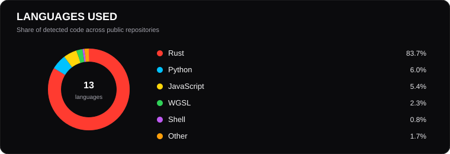
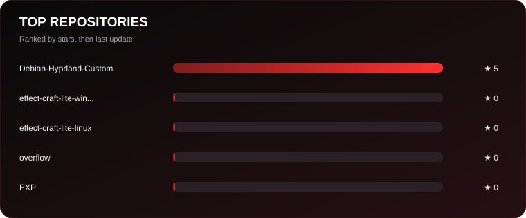

  

  
<strong>Student Developer · Senegal 🇸🇳</strong>

  
Building software. Exploring systems. Creating solutions.

  
  
  

---

## 

I'm a student developer from Senegal passionate about **Linux, open source, software development and cybersecurity**.

I learn by building real projects, exploring system internals and experimenting with new technologies. My goal is to create useful, accessible and innovative software.

## 

<table>
  <tr>
    <td width="50%" valign="top">
      <h3>01 · Debian Hyprland Custom</h3>
      A customizable Debian environment powered by Hyprland, focused on a clean workflow and system configuration.
    </td>
    <td width="50%" valign="top">
      <h3>02 · ClasseXP</h3>
      An educational platform concept designed to support teachers and students with digital learning tools.
    </td>
  </tr>
  <tr>
    <td width="50%" valign="top">
      <h3>03 · MirrorBridge</h3>
      Screen mirroring and device integration experiments for Linux, Android and iPhone.
    </td>
    <td width="50%" valign="top">
      <h3>04 · RePhone Lab</h3>
      Experiments focused on giving old smartphones a second life through lightweight Linux-based solutions.
    </td>
  </tr>
  <tr>
    <td colspan="2" valign="top">
      <h3>05 · FX Pro / Ease Pro</h3>
      Creative tools and workflow experiments inspired by professional motion-graphics software.
    </td>
  </tr>
</table>

## 

  

  

    
    
    
    
  

## 

- Linux internals and system engineering
- Software architecture and backend development
- REST APIs, databases and performance
- Cybersecurity fundamentals
- Rust and TypeScript

## 

<!-- PROFILE-STATS:START -->

| Public repositories | Stars earned | Forks | Followers |
|:--:|:--:|:--:|:--:|
| **6** | **5** | **0** | **1** |

**Most used languages:** `Rust`, `Python`, `JavaScript`, `WGSL`, `C`, `Shell`

### Selected repositories

| Repository | Description | Stars |
|:--|:--|:--:|
| [**Debian-Hyprland-Custom**](https://github.com/kolemm14/Debian-Hyprland-Custom) | No description provided. | 5 |
| [**effect-craft-lite-windows**](https://github.com/kolemm14/effect-craft-lite-windows) | No description provided. | 0 |
| [**effect-craft-lite-linux**](https://github.com/kolemm14/effect-craft-lite-linux) | No description provided. | 0 |

Last updated: 2026-11-06 06:58 UTC
<!-- PROFILE-STATS:END -->

## 

  
  
  
  
  
  

    
  <i>“Less noise. More building.”</i>
    
  
  

